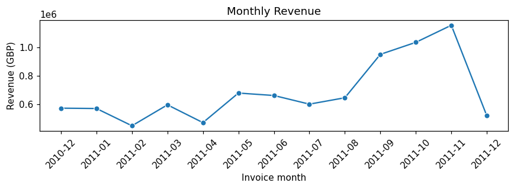
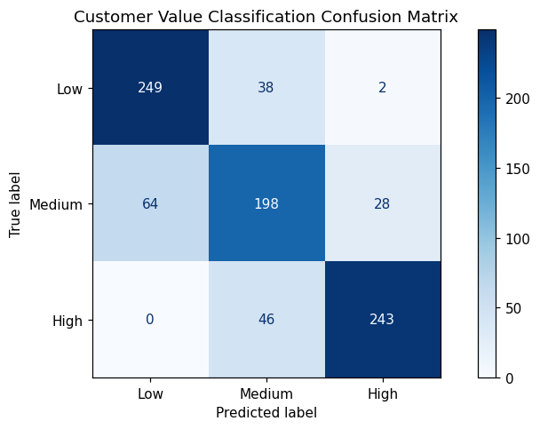
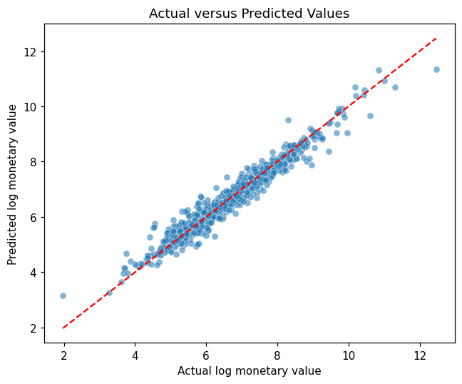

# Retail Customer Analytics

**Author:** Benjamin Dwomoh  
**Portfolio context:** Developed from MSc Data Analytics coursework and revised for reproducibility, clearer interpretation and responsible model reporting.
**Tools:** Python, pandas, NumPy, Matplotlib, seaborn and scikit-learn

## Project overview

This project analyses 541,909 transactions from a UK-based online retailer to understand completed-purchase revenue, historical customer value and purchasing behaviour. It combines transaction cleaning, RFM-style feature engineering, supervised machine learning and customer segmentation to identify patterns that can inform testable marketing and retention hypotheses.

## Business questions

1. How does completed-purchase revenue vary over time, by product and by country?
2. Which historical customer characteristics are associated with monetary value?
3. Can customers be grouped into interpretable segments for differentiated marketing tests?
4. How accurately can historical value tiers be reconstructed from customer behaviour features?

## Dataset and contribution

The source contains **541,909 transaction rows** from December 2010 to December 2011. I prepared the data, engineered customer-level features, conducted the analysis, developed the models and interpreted the results. I did not collect the original dataset.

Purchase-only cleaning removed duplicate records, missing customer identifiers, cancellations and non-positive purchases. The resulting analysis dataset contained **392,692 transactions** representing **4,338 customers**.

## Analytical workflow

1. Audit and clean transaction data.
2. Create customer-level recency, frequency, monetary and behavioural features.
3. Explore revenue patterns across time, products and countries.
4. Compare Linear Regression and Random Forest for historical monetary-value reconstruction.
5. Use Logistic Regression to classify historical customer-value tiers.
6. Compare K-means solutions using inertia and silhouette scores.
7. Profile the selected customer segments and translate the findings into testable business hypotheses.

## Key results

### Model comparison

| Analytical task | Model | Evaluation result |
|---|---|---:|
| Historical value reconstruction | Linear Regression, 80/20 split | R-squared = 0.521 |
| Historical value reconstruction | Random Forest, 80/20 split | R-squared = 0.949 |
| Historical value-tier classification | Logistic Regression | Accuracy = 79.49% |
| Customer segmentation | K-means, k = 2 | Silhouette score = 0.433 |

The regression metrics were calculated on `log(1 + historical monetary value)`. These results measure same-period historical reconstruction and must not be interpreted as future-spending or customer-lifetime-value forecasts.

### Customer segments

K-means selected two clusters after comparing values of `k` from 2 to 8. The business-friendly names below are interpretive labels based on the cluster profiles; they are not observed customer categories.

| Segment | Customers | Median recency | Median frequency | Median monetary value | Interpretation |
|---|---:|---:|---:|---:|---|
| Occasional or At-Risk Customers | 2,672 | 96 days | 1 invoice | GBP 363.08 | Less recent, infrequent customers who may be suitable for carefully tested re-engagement activity |
| Active High-Value Customers | 1,666 | 16 days | 6 invoices | GBP 2,061.08 | Recent, repeat customers who may be suitable for retention and loyalty tests |


### Selected visual results

#### Monthly completed-purchase revenue



December 2011 is incomplete and should not be compared directly with complete months.

#### Historical value-tier classification



#### Historical monetary-value reconstruction



## Business insights and recommendations

- **Retention hypothesis:** Active High-Value Customers purchased more recently and frequently and had substantially higher historical spending. Test whether loyalty benefits, early access or personalised offers improve repeat purchasing in this group.
- **Re-engagement hypothesis:** Occasional or At-Risk Customers had a median recency of 96 days and only one historical invoice. Test a reactivation campaign against a suitable control group before making broad claims about its effectiveness.
- **Geographic analysis:** The United Kingdom dominates revenue, so aggregate international comparisons can obscure smaller markets. Analyse major non-UK markets separately before creating country-specific strategies.
- **Product planning:** Use the highest-revenue products as candidates for merchandising and cross-selling analysis, but evaluate units sold, margins and returns before drawing profitability conclusions.
- **Measurement:** Treat the segments as targeting hypotheses rather than proven marketing solutions. Measure campaign lift, conversion, incremental revenue and retention using new outcome data.

## Visualisation notes

- The sharp December 2011 decline reflects an incomplete month rather than confirmed business deterioration.
- The United Kingdom dominates the country chart. A follow-up analysis should compare non-UK markets separately or use a transformed scale.
- PCA is used only to visualise the K-means solution in two dimensions; clustering was performed on the standardised log-transformed RFM features.

## Limitations

- Supervised models use behavioural features and monetary targets from the same historical window. They reconstruct historical value rather than forecast future spending.
- Historical value tiers are defined using quantiles from the complete descriptive sample. A production workflow should derive and freeze tier thresholds using training data only.
- Cancellations and non-positive purchases are excluded, so the analysis reports completed-purchase revenue rather than net revenue after returns.
- December 2011 is incomplete.
- Missing customer identifiers reduce customer-level coverage.
- The two clusters are descriptive groups, and the silhouette score does not establish commercial usefulness.
- Recommendations are testable hypotheses; no causal campaign effect was evaluated.

## Run the analysis

Use Python 3.11 or newer. From the repository folder, create and activate a virtual environment.

```bash
python -m venv .venv
```

Windows PowerShell:

```powershell
.venv\Scripts\Activate.ps1
```

macOS/Linux:

```bash
source .venv/bin/activate
```

Install the packages and start Jupyter:

```bash
python -m pip install -r requirements.txt
python -m jupyter lab
```

Place the source dataset in `data/` as described in [data/README.md](data/README.md). Open [analysis.ipynb](analysis.ipynb), restart the kernel and run all cells. Saved outputs are included for readers who only want to inspect the work.

## Repository structure

```text
retail-customer-analytics/
├── analysis.ipynb       # Explained analysis with executed outputs
├── figures/             # Exported analysis charts
├── data/README.md       # Dataset source and placement instructions
├── requirements.txt     # Analysis dependencies
├── VALIDATION.md        # Execution and scope checks
├── LICENSE              # Licence for the original project code
└── README.md            # Project overview and findings
```

## Validation

The analytical workflow underlying the saved results was executed sequentially against the original dataset without errors. A later presentation-only cleanup consolidated duplicate imports without changing the analytical logic or saved results. See [VALIDATION.md](VALIDATION.md) for the validation scope and environment details.

## Data source

Chen, D. (2015). *Online Retail*. UCI Machine Learning Repository.

https://doi.org/10.24432/C5BW33

https://archive.ics.uci.edu/dataset/352/online+retail

UCI lists the dataset under the CC BY 4.0 licence. The repository does not redistribute the raw dataset.
