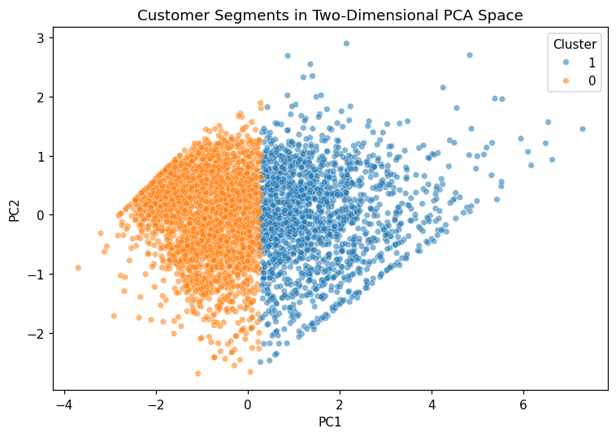

# Retail Customer Analytics

**Author:** Benjamin Dwomoh  
**Context:** MSc Data Analytics coursework, reviewed for a public portfolio  
**Tools:** Python, pandas, NumPy, Matplotlib, seaborn, scikit-learn

## Analytical question

How do completed-purchase revenue and customer purchasing behaviour vary, and what segments might inform marketing hypotheses?

## Data and my contribution

541,909 source transaction rows; UK-based online retail data from December 2010 to December 2011. Supplied for my MSc assignment. I worked on data preparation, analysis, modelling and interpretation; I did not collect the original dataset.

## Approach

Data auditing and purchase-only cleaning; historical RFM features; descriptive revenue charts; Linear Regression and Random Forest; Logistic Regression for value tiers; K-means with silhouette comparison and PCA visualisation.

## Results

- Purchase-only cleaning retained **392,692 transaction rows** representing **4,338 customers**.
- RFM clustering selected **2 clusters**, with a silhouette score of **0.433**. The groups differed in median recency (96 versus 16 days), frequency (1 versus 6 invoices) and monetary value (GBP 363 versus GBP 2,061).
- Logistic Regression achieved **79.49% accuracy** when classifying historical low, medium and high value tiers.
- Random Forest achieved **R-squared 0.949** on log historical monetary value in the 80/20 split, compared with **0.521** for Linear Regression. This is same-period reconstruction and must not be described as future-value forecasting.
- The UK dominated revenue. Use the segments to form campaign hypotheses, then validate interventions with new outcome data.

## Example chart



## Limitations

Supervised models use features and monetary targets from the same historical window. Results describe historical value reconstruction, not future spending or customer lifetime value. Tier thresholds are calculated on the full descriptive sample. A forecasting extension requires a time-based split and separate observation and outcome windows. Cancellations and non-positive purchases are excluded, so revenue is not net of returns. December 2011 is incomplete. Segment recommendations are hypotheses rather than tested marketing effects.

## Run the analysis

Use Python 3.11 or newer. From this repository folder:

```bash
python -m venv .venv
```

Activate the environment on Windows PowerShell:

```powershell
.venv\Scripts\Activate.ps1
```

Or on macOS/Linux:

```bash
source .venv/bin/activate
```

Then install the packages and start Jupyter:

```bash
python -m pip install -r requirements.txt
python -m jupyter lab
```

Place the source dataset in `data/` as described in [data/README.md](data/README.md). Open [analysis.ipynb](analysis.ipynb), then restart the kernel and run all cells. The notebook includes saved outputs for readers who only want to inspect the work.

Core analysis package versions are pinned to the validation environment. JupyterLab is a frontend dependency; it was not available in the validation environment. Validation executed Python cells sequentially with a lightweight runner and captured tables and Matplotlib outputs rather than using a Jupyter kernel.


## Files

- `analysis.ipynb`: explained analysis with executed outputs.
- `figures/`: saved charts produced by the notebook.
- `requirements.txt`: analysis dependencies.
- `data/README.md`: dataset source and placement instructions.
- `VALIDATION.md`: execution checks and scope.

## Source

Chen, D. (2015). Online Retail. UCI Machine Learning Repository. https://doi.org/10.24432/C5BW33. UCI lists the dataset under CC BY 4.0.

https://archive.ics.uci.edu/dataset/352/online+retail
